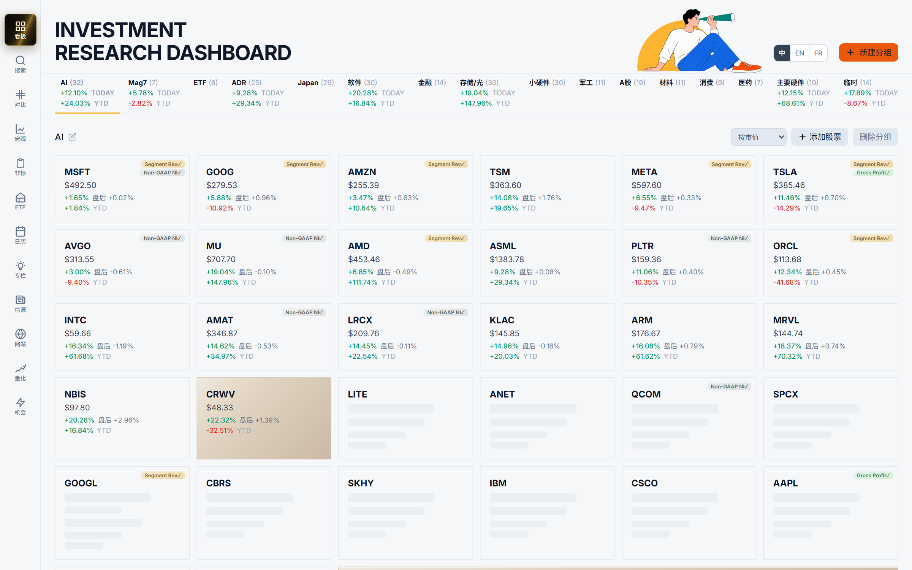

# Investment Research Dashboard

A web dashboard for US equity research — financial statements, institutional holdings,
quantitative factors, macro series and sector rotation in one place, built directly
on primary sources rather than third-party data aggregators.

**Live** → https://investment-dashboard.up.railway.app/

---

## What this is

Most research tools are data viewers: they wrap an existing vendor feed in a nicer
chart. That works until you need something the vendor did not think to expose — a
segment breakdown buried in an 8-K, an RPO number, a factor you want to compute
yourself.

This project pulls the raw material and turns it into something you can act on.

---

## Financial statements, read from the filing itself

Revenue, segment splits, non-GAAP reconciliations, remaining performance obligations
and forward guidance are parsed directly from SEC EDGAR **8-K / 10-Q / 10-K** filings
— not bought from a data vendor.

That pays off in three ways:

- **The line items a vendor doesn't carry.** Segment revenue, RPO, guidance ranges,
  non-GAAP-to-GAAP bridges — you get them because you read the document.
- **Control over definitions.** You decide what counts as "adjusted", and the
  reconciliation is visible rather than assumed.
- **Visual output, not a wall of tables.** Every parsed figure lands in a chart you
  can compare across tickers and across quarters — revenue composition, margin
  trends, EPS surprise history, segment contribution.

---

## Macro and non-standard data

Beyond single names, the dashboard tracks the wider context:

- **Macro series** — rates, inflation, FX majors and precious metals from FRED,
  with an early-warning panel for growth and inflation surprises, and a
  multi-select chart that overlays any combination of series on a shared axis
- **GPU pricing** — real-time cloud compute pricing across providers, tracked as a
  time series rather than a one-off snapshot
- **AI model rankings** — intelligence index vs. cost-per-task, with a Pareto
  frontier separating US and Chinese model families
- **Non-standard datasets** — alt-data feeds and custom series that don't fit a
  standard financial data model

---

## Quantitative factors

Eight self-built factors, with the formula and the backtest both visible:

| Factor | What it measures |
|---|---|
| Residual momentum | Momentum after regressing out SPY |
| WorldQuant Alpha #74 | Price momentum composite |
| Volatility-adjusted momentum | Return scaled by realised vol |
| ATR low-volatility | Low-volatility anomaly |
| CORR5 | Rolling price–volume correlation |
| Bollinger position | %B within the band, inverted |
| OBV slope | Normalised on-balance-volume trend |
| KLOW / opening gap | Candlestick and overnight-gap signals |

Each comes with IC / RankIC analysis, a five-quintile backtest, and a decay curve
across horizons from 1 to 60 days.

---

## Interface

---

## Data sources

| Data | Source |
|---|---|
| Prices (daily, intraday, options) | Exchange market-data API |
| Institutional holdings (13F) | SEC EDGAR raw XML |
| Financial statements | SEC EDGAR 8-K, 10-Q, 10-K |
| Macro indicators | FRED |
| Factor backtests | Self-built, 5-year daily panel |

---

## Stack

- **Backend** — FastAPI + PostgreSQL
- **Frontend** — Alpine.js, Chart.js, ECharts
- **Deploy** — Railway
- **i18n** — Chinese / English / French, via a runtime DOM translation layer

---

## Note

A personal research tool. Data comes from public sources and is provided for
information only — not investment advice.
