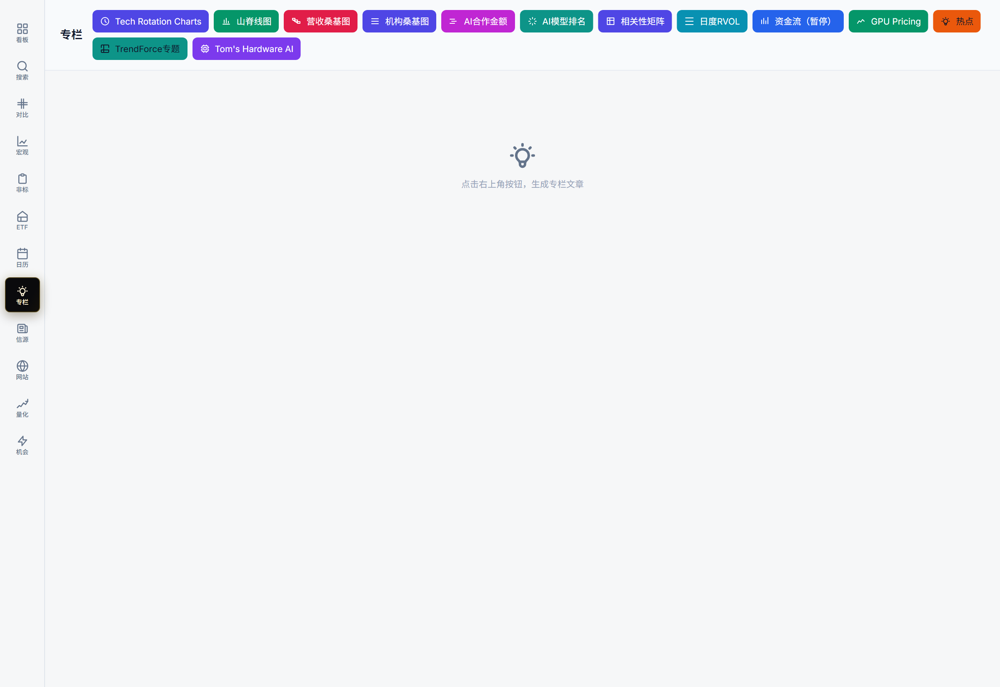
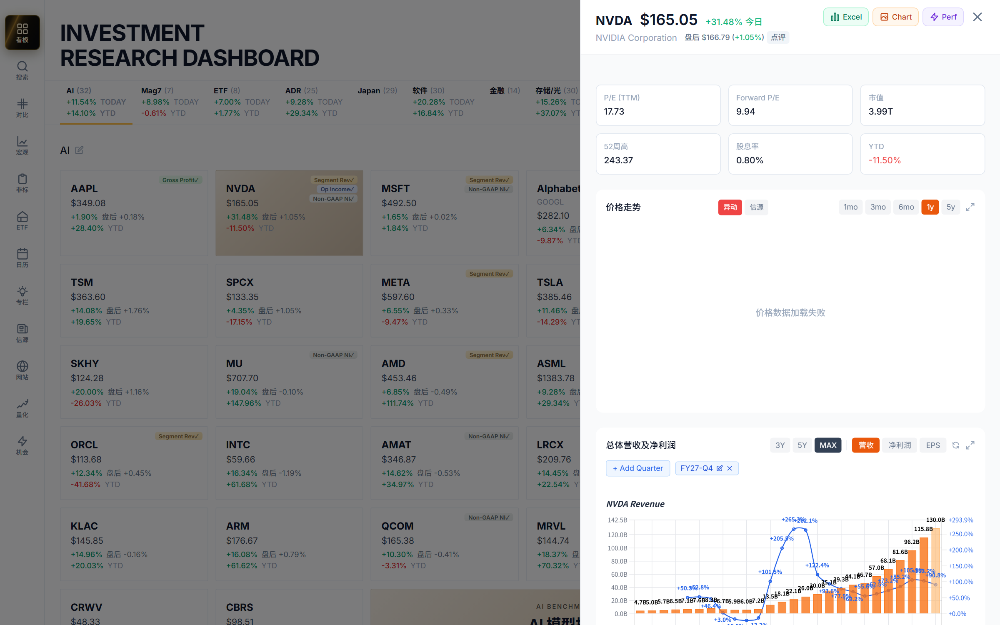

# 投资研究看板 · Investment Research Dashboard

一个面向美股投研的 Web 看板：把**机构持仓、财报原始数据、量化因子、板块轮动**放在同一个界面里，
数据全部来自一手来源（SEC EDGAR / 交易所行情 API），不经过第三方聚合商。

**在线访问** → https://investment-dashboard.up.railway.app/

---

## 为什么做这个

大多数投研工具是「数据展示器」：把现成的数据源包装成好看的图。
但真正做研究时会发现，几个关键地方的数据是被加工过、甚至处理错误的。

这个项目主要想解决三类问题：

### 一、机构持仓的真实性

13F 里同一只股票可能有多条记录：普通股、看涨期权、看跌期权，用 `<putCall>` 字段区分。
**期权的 shares 是标的股数，不是实持股数**——不区分就相加，持仓会被严重高估。

实测案例（Millennium 持有 NVDA，2026 Q3）：

| 项目 | 股数 |
|---|---|
| 普通股 | 13,041,779 |
| Call 标的股数 | 13,257,800 |
| Put 标的股数 | 31,112,100 |
| **混算结果** | **57,411,679**（虚高 4.4 倍）|

本看板把三类分开统计，只把普通股计入持仓，期权敞口单独标注。
环比也从错误的 +27.1% 恢复为真实的 +7.3%。

### 二、财报数字直接读原文

营收、分部收入、non-GAAP 对账、RPO（剩余履约义务）、指引——这些直接从
SEC 的 8-K / 10-Q / 10-K 文件解析，而不是买第三方整理好的数据。
好处是口径可控、能拿到第三方数据库没有的细项。

### 三、自己算的因子

8 个自建量化因子，公式和回测逻辑都可见：

- 残差动量（对 SPY 回归后的超额动量）
- World Quant Alpha #74
- 波动率调整动量（VAM）
- ATR 低波动
- CORR5 价量相关
- 布林带位置
- OBV 归一化斜率
- KLOW 下影线、开盘跳空

每个因子都带 IC / RankIC 分析和五分层回测。

**ROE 因子（PIT 对齐）** —— 财报数据按「提交日」而非「期末日」对齐，
避免回测偷看未来。Q3 财报 11 月 16 日提交，11 月 15 日的截面仍然使用 Q2 数据。

---

## 界面

### 专栏 · 内容矩阵与机构持仓

每周自动生成的板块周报、17 家顶级对冲基金的持仓变化桑基图、
AI 板块资金流、GPU 云算力价格追踪。

### 个股详情

行情、技术指标、财报、机构持仓、相关杠杆 ETF 集中在一页。

### 自选股总览

---

## 数据来源

| 数据 | 来源 |
|---|---|
| 行情（日线/分时/期权） | 交易所行情 API |
| 13F 机构持仓 | SEC EDGAR 原始 XML |
| 财报（营收/分部/non-GAAP） | SEC EDGAR 8-K、10-Q、10-K |
| 宏观指标 | FRED |
| 因子回测数据 | 自建，5 年日频 |

---

## 技术栈

- **后端**：FastAPI + PostgreSQL
- **前端**：Alpine.js + Chart.js + ECharts
- **部署**：Railway
- **多语言**：中文 / English / Français（运行时 DOM 替换层）

---

## 一些研究笔记

做这个项目过程中整理的分析，都是基于自己的数据验证的：

- **13F 数据里机构持仓被系统性高估** —— 期权混算问题，见上文
- **AMD 的期权市场在为「波动幅度」而非「方向」定价** —— 前端 IV 98% 但 IV/HV 只有 0.60，期权相对已实现波动打了六折
- **ROE 在 S&P100 上几乎无预测力，但在 NDX100 上有分层差异** —— IC 从 -0.004 到分层收益 Q1/Q5 差距明显

---

## 说明

本项目为个人研究工具，不提供投资建议。数据来自公开渠道，
分析结论仅供参考，不构成任何买卖建议。
